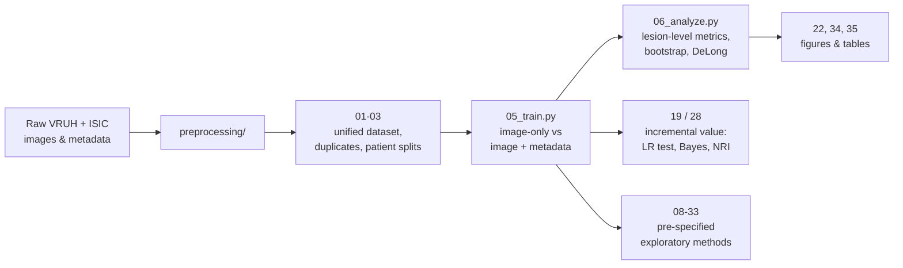

# Multimodal Deep Learning for Melanoma Invasiveness Prediction and the Added Value of Clinical Metadata: Retrospective Diagnostic Accuracy Study


## 📄 Abstract

**Background:** Deep learning models have shown promising performance in melanoma diagnosis; however, most existing approaches rely exclusively on image data. In routine practice, dermatologists integrate dermoscopic findings with clinical information such as patient age, sex, lesion size, and anatomical location. Multimodal models have therefore emerged as a promising strategy to better reflect real-world clinical decision-making. Nevertheless, the specific contribution of clinical metadata to the task of differentiating melanoma in situ (Mis) from invasive melanoma (Miv) remains poorly understood. When public and institutional datasets are pooled, differences between sources may also confound the apparent value of metadata.

**Objective:** This study aimed to evaluate whether the integration of routinely available clinical metadata improves the performance of a deep learning model for distinguishing Mis from Miv compared with an image-only approach.

**Methods:** A dataset comprising 2,361 histopathologically confirmed dermoscopic images (728 Mis and 1,633 Miv) of 880 lesions (272 Mis and 608 Miv) from 860 patients was assembled from two independent sources: Virgen del Rocío University Hospital (VRUH) and the ISIC archive. Associated metadata consisted of patient age, sex, anatomical location, and lesion diameter. Performance was estimated with 5-fold cross-validation repeated 3 times and grouped by patient. We developed a multimodal deep learning framework that integrated dermoscopic images and metadata using gated fusion and cross-attention mechanisms. It was compared with simple concatenation and image-only models trained with an identical recipe. The prespecified primary end point was the lesion-level difference in the area under the receiver operating characteristic curve (AUC) between the concatenation and image-only models (95% CIs from a patient-level bootstrap). Source confounding was examined with source-stratified, single-source, source-adjusted and leave-one-source-out analyses.

**Results:** The multimodal and image-only models achieved similar lesion-level discrimination (AUC 0.762 vs 0.760; difference +0.002, 95% CI −0.020 to 0.024; P=.87), also in VRUH alone (−0.006, 95% CI −0.033 to 0.020) and beyond an explicit source indicator (−0.002, 95% CI −0.022 to 0.018). However, in secondary post hoc analyses, the metadata carried statistically significant incremental information beyond the image model (odds ratio 1.37 per SD; likelihood ratio test P=.011; VRUH only, P=.017), with a Bayesian posterior probability of a positive contribution of 98.3% to 99.1% and a net reclassification improvement of 0.22 (Holm-adjusted P=.009). Threshold sensitivity analyses demonstrated that model performance could be adjusted according to different clinical priorities by modifying the decision threshold.

**Conclusions:** The integration of clinical metadata provided statistically significant incremental information for differentiating Mis from Miv beyond image-only models, although its magnitude was small and did not translate into significantly better discrimination, highlighting the value of clinically relevant information as a complement to dermoscopic image analysis. Source confounding and differential missingness should be controlled when evaluating multimodal dermatology artificial intelligence.

**Keywords:** melanoma; dermoscopy; artificial intelligence; deep learning; clinical metadata; multimodal learning; diagnostic imaging

## ✨ What makes this pipeline different

- 🧑‍⚕️ **Patient-level evaluation.** 5-fold cross-validation repeated 3 times, grouped by patient, with an internal
  validation set used *only* for early stopping, checkpoints and thresholds. Results are reported per lesion.
- ⚖️ **Fair comparisons.** Image-only and image + metadata models share exactly the same training recipe, and any
  tuning budget is applied to both.
- 🕵️ **Source-confounding checks.** Pooling a hospital cohort (VRUH) with the public ISIC Archive can create shortcuts:
  class prevalence and metadata missingness differ by source. The pipeline includes source-stratified, single-source,
  source-adjusted and leave-one-source-out analyses, plus permuted-metadata controls.
- 📊 **Proper statistics.** Patient-level cluster bootstrap, DeLong and McNemar tests, Holm correction, calibration,
  decision curves, and nested-model, Bayesian and reclassification analyses of the incremental value of the metadata.
- 🔒 **Pre-specified exploration.** Every exploratory method was run under a protocol fixed in advance and gated on
  validation data only:
  - fusion: gated cross-attention, FiLM, late fusion, TabPFN;
  - training: modality-balanced training, distillation, SWA;
  - image side: ResNet50, higher resolution, the MONET dermatology foundation model;
  - and more.

## 🧭 Pipeline at a glance



## 🧠 Models

| Model | Inputs | Fusion |
|---|---|---|
| Image only | Dermoscopic image | DenseNet121 → classifier |
| Concatenation | Image + metadata | Image features ‖ metadata MLP → classifier |
| Attention-based fusion | Image + metadata | Gate + spatial cross-attention + auxiliary heads |
| Metadata only | Age, sex, site, diameter | Logistic regression |

Metadata are encoded with training-fold statistics only, and missing values are handled per source, so that
missingness cannot leak the label. Mixup interpolates images, metadata and labels with the same coefficient.

## 📁 Repository structure

| Path | Content |
|---|---|
| `preprocessing/` | Builds the image lists and metadata tables (`reports/*.csv`) from the raw VRUH and ISIC data |
| `pipeline/` | Main pipeline: numbered scripts, run in order |
| `pipeline/common.py`, `pipeline/experiments.py` | Data loading, metadata encoding, models and the registry of every experiment |
| `pipeline/slurm/` | SLURM scripts and task lists for an HPC cluster |
| `legacy/train_v3.py` | Earlier training script, used only by the audit in `pipeline/00_audit_legacy.py` |

## 🚀 Quick start

```bash
pip install -r requirements.txt

# 1. Build the metadata tables from the raw data (paths inside the scripts)
python preprocessing/VRUH_1_generate_image_data.py && python preprocessing/VRUH_2_get_meta_and_images.py
python preprocessing/ISIC_1_generate_image_data.py && python preprocessing/ISIC_2_get_meta_and_images.py

# 2. Unified dataset, duplicate screen and patient-level splits
python pipeline/01_prepare_data.py
python pipeline/02_check_duplicates.py
python pipeline/03_make_splits.py

# 3. Train one experiment on one split (or launch them all with pipeline/slurm/run_array.sbatch)
python pipeline/05_train.py --exp concat_meta --split cv_r0_f0

# 4. Statistics, incremental value and figures
python pipeline/06_analyze.py
python pipeline/19_incremental_value.py
python pipeline/28_bayes_reclass.py
python pipeline/22_figures.py
```

`pipeline/experiments.py` lists every experiment that `--exp` accepts. `pipeline/slurm/run_weights.sbatch` retrains
the cross-validation models and saves their weights. `pipeline/29_x12_tabpfn_monet.py` runs in its own environment
(`requirements_x12.txt`).

## 🗂️ Data

Clinical data and images are **not** included in this repository.

- **VRUH** (Virgen del Rocío University Hospital, Seville): available from the authors on reasonable request, subject
  to ethics approval.
- **ISIC Archive**: dermoscopic images of histopathologically confirmed melanoma with a recorded Breslow thickness,
  available at [isic-archive.com](https://www.isic-archive.com/).

## 📜 License

Released under the [GNU GPLv3](LICENSE).
